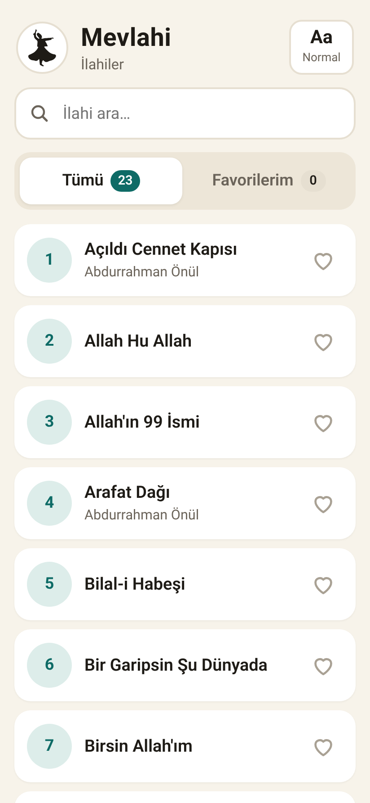
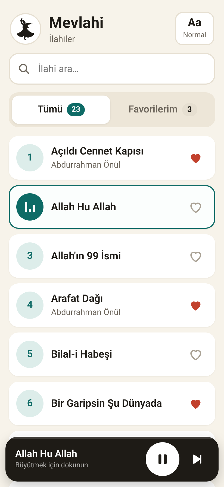
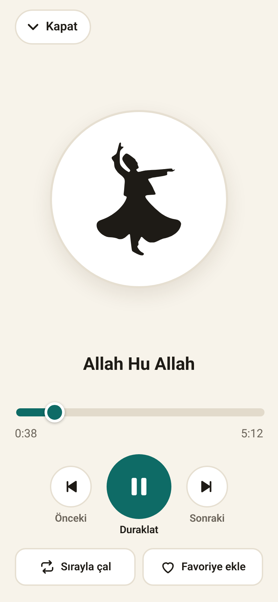
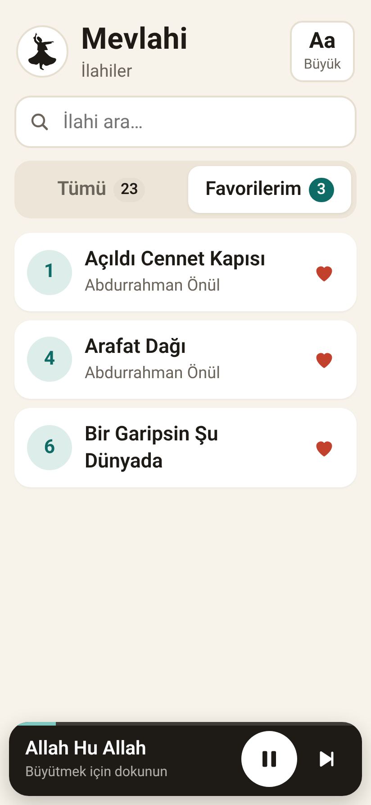

<p align="center">
  
</p>

<h1 align="center">Mevlahi</h1>

<p align="center">
  Büyük yazılı, sade ve kolay kullanılan bir ilahi dinleme uygulaması.<br>
  İnternet gerektirmez: ilahiler uygulamanın içinde gelir.
</p>

<p align="center">
  
  
  
  
</p>

## Özellikler

- **Yaşlı kullanıcılar için tasarlandı:** büyük yazılar, büyük dokunma alanları, her düğmenin altında yazılı açıklama
- **Yazı boyutu ayarı:** sağ üstteki **Aa** düğmesiyle Normal / Büyük / Çok büyük
- **Büyük çalar ekranı:** dönen semazen, kolay ileri-geri sarma çubuğu, Önceki / Oynat / Sonraki
- **Favoriler:** kalbe dokunarak sevilen ilahileri ayrı sekmede toplama
- **Arama:** Türkçe karakter yazmadan da bulur (`guller` → *Güller Ağlıyor*)
- **Tekrarla:** tek ilahiyi tekrar tekrar çalma ya da sırayla çalma
- **Son dinlenen hatırlanır,** geri tuşuyla çıkınca ilahi arka planda çalmaya devam eder
- İnternet izni yok, reklam yok, veri toplamaz

## İlahiler

Uygulamada şu an 23 ilahi var:

1. Açıldı Cennet Kapısı — Abdurrahman Önül
2. Allah Hu Allah
3. Allah'ın 99 İsmi
4. Arafat Dağı — Abdurrahman Önül
5. Bilal-i Habeşi
6. Bir Garipsin Şu Dünyada
7. Birsin Allah'ım
8. Bu Gidiş Nereye
9. Canlar Canı
10. Cürmüm İle Geldim Sana
11. Dağ Taş Allah Der
12. Dem Bu Demdir
13. Güller Ağlıyor
14. Hasbi Rabbi
15. Kâbe'de Hacılar — Abdurrahman Önül & Celal Karatüre
16. Kerbela
17. Medine Yolları — Abdurrahman Önül
18. Muhammed
19. Nerdesin Ya Resulallah
20. Seher Vakti Bülbüller
21. Uçun Kuşlar — Abdurrahman Önül
22. Ya İlahi Senden Bir Dileğim Var
23. Yakma Ya Rabbi

## İlahi ekleme

MP3 dosyalarını şu klasöre koymanız yeterli, kod değiştirmeye gerek yok:

```
app/src/main/assets/www/audio/
```

Baştaki numara sıralamayı belirler. Türkçe karakterli adlar `ilahiler.json` dosyasından gelir; bir ilahi orada yoksa adı dosya adından üretilir:

| Dosya adı | Listede görünen |
|---|---|
| `01 - Yunus Emre - Dertli Dolap.mp3` | **Dertli Dolap** · Yunus Emre |
| `02 - Hasbiyallah.mp3` | **Hasbiyallah** |

`ilahiler.json` örneği:

```json
{
  "13-guller-agliyor.mp3": { "title": "Güller Ağlıyor" },
  "24-yeni-ilahi.mp3": { "title": "Yeni İlahi", "artist": "Okuyan kişi" }
}
```

## Kurulum (APK)

1. Bu repoda **Actions** sekmesine gidin.
2. En son başarılı **Android APK** çalışmasını açın.
3. Aşağıdaki **Mevlahi-APK** dosyasını indirin, zipten çıkarıp telefona kurun.

## Yapı

| Bölüm | Teknoloji |
|---|---|
| Arayüz | HTML, CSS, JavaScript (`app/src/main/assets/www`) |
| Android kabuğu | Java, WebView (hiçbir harici kütüphane yok) |
| Derleme | Gradle 8.9, Android Gradle Plugin 8.5.2, JDK 17 |
| En düşük Android | 7.0 (API 24) |

Bilgisayarda derlemek için:

```bash
./gradlew assembleDebug
# çıktı: app/build/outputs/apk/debug/app-debug.apk
```

## Not

Uygulamaya eklenen ses kayıtlarının paylaşım hakları kayıt sahiplerine aittir. Repoyu herkese açık yayınlamadan önce kullandığınız kayıtların paylaşılmasına izin olduğundan emin olun.
